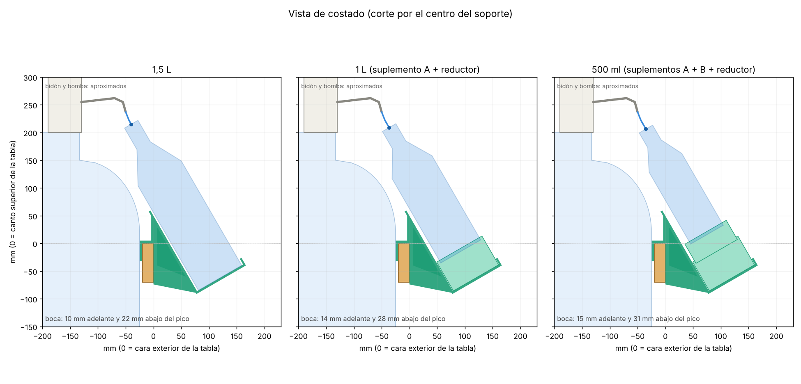
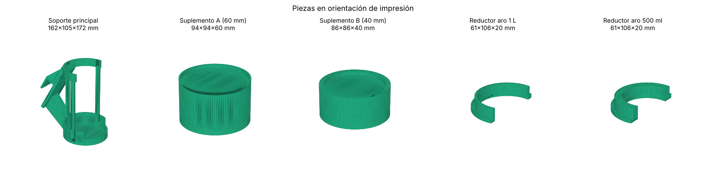

# Soporte del bidón

Soporte imprimible en 3D para llenar botellas desde la bomba eléctrica de un bidón de 20 L, sin tener que sostenerlas. Se cuelga de la tabla frontal del mueble donde está el bidón y sostiene la botella inclinada debajo del pico.



## Cómo funciona

- **Gancho en U** sobre la tabla frontal del mueble (18 a 20 mm de espesor). Se desliza a lo largo de la tabla para acomodarlo debajo del pico.
- **Copa inclinada** donde apoya la base de la botella y carga todo el peso.
- **Aro en C** abierto adelante que mantiene el ángulo. La botella entra de frente.
- El cuello de la botella no carga peso.

La botella queda inclinada 30° respecto de la vertical. El pico de la bomba termina casi horizontal y el chorro avanza cerca de 1 cm hacia adelante, así que la boca queda pegada al pico: con la botella de 1,5 L, 10 mm adelante y 22 mm abajo de la punta.

## Botellas

| Botella | Piezas extra |
|---|---|
| 1,5 L | ninguna |
| 1 L | suplemento A en la copa + reductor de aro de 1 L |
| 500 ml | suplementos A + B en la copa + reductor de aro de 500 ml |

## Visor 3D

`index.html` es un visor 3D autocontenido: se abre en el navegador, se gira con el mouse o el dedo y permite cambiar entre las tres botellas.

## Imprimir

Los STL están en [`stl/`](stl/), junto con [`LEEME-impresion.txt`](stl/LEEME-impresion.txt).

- PETG, boquilla 0,4 mm, capa 0,2 mm, 4 perímetros, 25 % de relleno giroide.
- Todas las piezas entran en una cama de 220 × 220 mm.
- `soporte_principal.stl` ya viene orientado (piso de la copa sobre la cama) y necesita soportes tipo árbol debajo del aro y del gancho. El resto se imprime sin soportes.



## Modificar el diseño

El modelo es paramétrico y está en [`modelo/soporte.py`](modelo/soporte.py). Las medidas del mueble, del pico y de las botellas están al principio del archivo.

```bash
pip install manifold3d trimesh matplotlib shapely networkx rtree
cd modelo
python soporte.py         # genera los STL en modelo/out/
python render.py          # genera las imágenes en modelo/out/
python export_viewer.py   # genera modelo/out/viewer_data.json para el visor
```

Para regenerar el visor, reemplazá `__DATA__` en `viewer_template.html` por el contenido de `out/viewer_data.json` y guardalo como `index.html`.

## Medidas usadas

- Tabla frontal: 20 mm de espesor, 70 mm de alto.
- Punta del pico: 237 mm sobre el canto de la tabla, 50 mm hacia adentro de la cara exterior, 140 mm del poste derecho.
- Botellas: rangos estándar (1,5 L de 310 a 330 mm de alto y 88 a 92 mm de diámetro).
