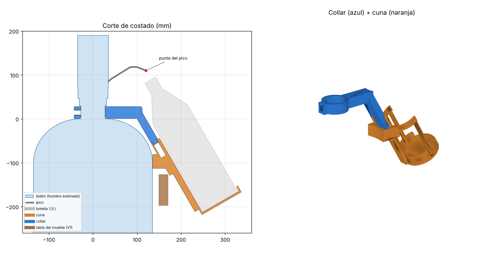
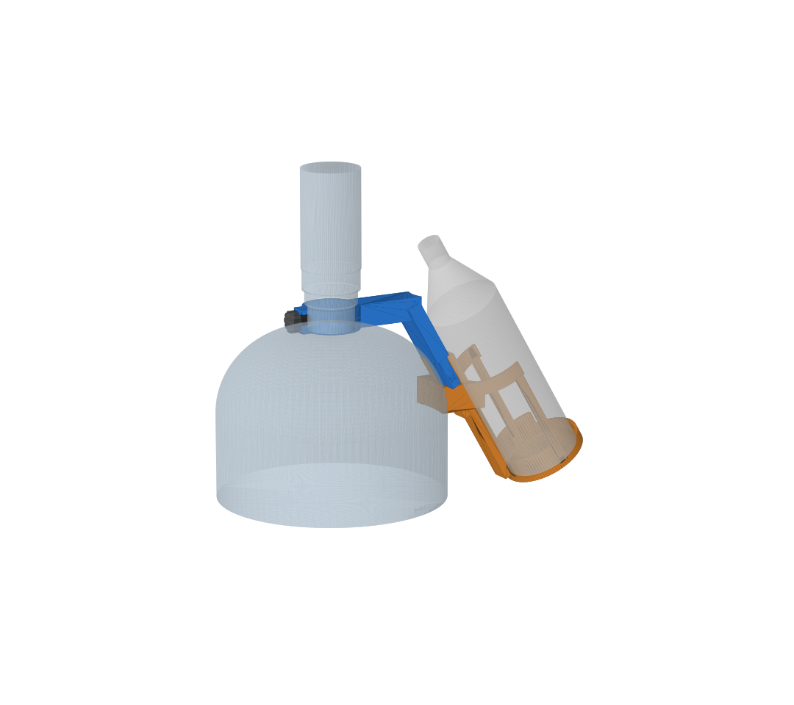
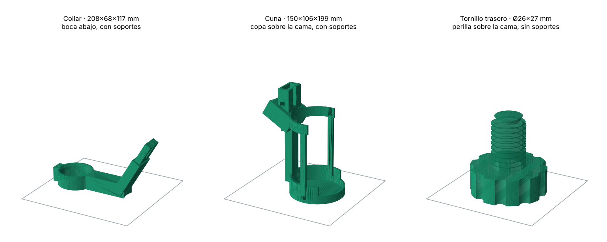

# Soporte del bidón V2.0

[← Todas las versiones](../README.md) · [Visor 3D](https://imprezwag.github.io/3d/v2.0/)

Soporte imprimible en 3D para llenar botellas desde la bomba eléctrica de un bidón de 20 L, sin tener que sostenerlas. A diferencia de la V1.1, no depende del mueble: abraza el cuello del bidón y se recuesta contra su parte más ancha, así que sirve para cualquier bidón retornable estándar.



## Cómo funciona

- **Collar:** anillo cerrado que se baja por el cuello del bidón (Ø55 mm, estándar) y se apoya en su base. Toma el peso y gira para ponerlo debajo del pico.
- **Tornillo trasero:** chico, con perilla, de apriete a mano. Aprieta el cuello contra el frente del anillo: saca el juego y evita que gire.
- **Apoyo contra el bidón:** la palanca de la botella empuja el soporte hacia el bidón, y un apoyo curvo en la espalda de la cuna se recuesta contra la parte más ancha (Ø270 mm, estándar). No depende de la forma del hombro.
- **Cuna:** la misma copa y el mismo aro en C de la V1.1. Encastra en una lengüeta del collar: el peso la asienta y dos dientes hacen clic. Sin bulones.

La botella queda inclinada 30° respecto de la vertical, con la boca 10 mm adelante y 22 mm abajo de la punta del pico (igual que la V1.1).



## Cómo se pone

1. Sacá la bomba y bajá el collar por el cuello del bidón.
2. Volvé a poner la bomba.
3. Girá el collar hasta que el brazo quede debajo del pico.
4. Apretá a mano el tornillo de atrás, sin forzar.
5. Bajá la cuna sobre la lengüeta hasta que haga clic.

Para cambiar el bidón: sacás la cuna, la bomba y el collar, y repetís.

## Botellas

| Botella | Piezas extra |
|---|---|
| 1,5 L | ninguna |
| 1 L | suplemento A en la copa + reductor de aro de 1 L |
| 500 ml | suplementos A + B en la copa + reductor de aro de 500 ml |

Suplementos y reductores son los mismos de la V1.1 (están copiados en `stl/`).

## Visor 3D

`index.html` es un visor 3D autocontenido: se gira con el mouse o el dedo, permite cambiar entre las tres botellas y separar la cuna para ver el encastre.

## Imprimir

Los STL están en [`stl/`](stl/), junto con [`LEEME-impresion.txt`](stl/LEEME-impresion.txt).

- PETG, boquilla 0,4 mm, capa 0,2 mm, 4 perímetros, 25 % de relleno giroide.
- Todas las piezas entran en una cama de 220 × 220 mm. La cuna mide 199 mm de alto: la impresora necesita al menos 200 mm de altura.
- `collar.stl` va boca abajo y `cuna.stl` con la copa sobre la cama (ya vienen orientados). Los dos necesitan soportes tipo árbol.
- `tornillo_trasero.stl` va con la perilla sobre la cama, sin soportes.



## Modificar el diseño

El modelo es paramétrico y está en [`modelo/soporte_v2.py`](modelo/soporte_v2.py). Las medidas del cuello, del pico, del bidón y de las botellas están al principio del archivo.

```bash
pip install manifold3d trimesh matplotlib shapely networkx rtree
cd modelo
python soporte_v2.py      # genera los STL en modelo/out/
python render.py          # chequea choques y genera las imágenes en modelo/out/
python export_viewer.py   # genera modelo/out/viewer_data.js para el visor
```

Para regenerar el visor, reemplazá `__DATA__` en `viewer_template.html` por el contenido de `out/viewer_data.js` y guardalo como `index.html`.

## Medidas usadas

- Cuello: Ø55 mm (estándar), 30 mm libres entre la unión con el hombro y el adaptador de la bomba.
- Bomba: 130 × 70 × 70 mm. Punta del pico a 120 mm del eje del cuello y 110 mm sobre la unión cuello-hombro.
- Bidón: Ø270 mm (estándar); parte más ancha estimada a unos 95 mm por debajo del cuello.
- Botellas: rangos estándar (1,5 L de 310 a 330 mm de alto y 88 a 92 mm de diámetro).

## A confirmar al probar

- Que el apoyo toque la parte más ancha del bidón sin inclinar de más el soporte. Si toca un poco más arriba o más abajo, el soporte se inclina 1 o 2 grados y la boca se corre unos milímetros.
- Que el clic de la traba sea firme y se pueda destrabar a mano.
- Con un bidón de hombro muy alto, la espalda del collar puede rozar el hombro.
